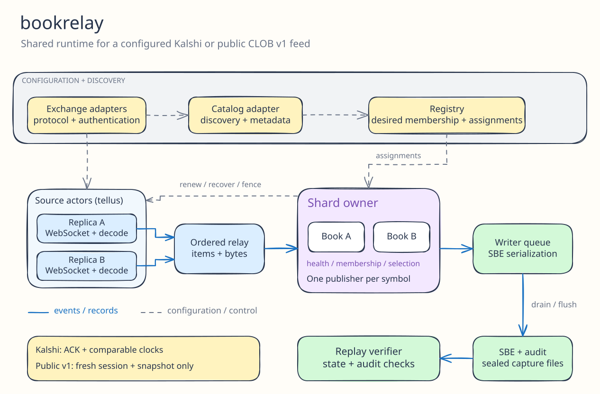

# Bookrelay

A Rust order book collector for the [Voluntas engineering challenge](https://voluntas.io/engineering-challenge).
It discovers regular live Kalshi markets, maintains independent redundant books,
and writes price-level updates and minute snapshots using the supplied SBE helpers.
A public Polymarket CLOB v1 adapter exercises the same collector and lifecycle code.

| Scope | Implementation |
| --- | --- |
| Base | Dynamic market discovery, multiple WebSockets, exact books, SBE output and SIGINT shutdown |
| E1 | Independent replicas, source selection and a snapshot before a source switch |
| E2 | Per-symbol activity monitoring, scoped recovery and staggered connection renewal |
| E3 | Exchange adapters for protocol, authentication and catalog; shared runtime with explicit ordering guarantees |
| E4 | Connection-comparison tooling and preliminary findings in [EXPERIMENTS.md](EXPERIMENTS.md) |

## Build and test

Use a Rust toolchain supporting edition 2024 and the locked dependencies. The
runtime was validated on Linux; the supplied binary-stdout helper uses `/dev/stdout`.

```bash
cargo build --release --locked
cargo test --locked
cargo fmt --all -- --check
cargo clippy --locked --all-targets -- -D warnings
```

With `just` installed, run the same formatting, strict Clippy and test checks:

```bash
just ci
```

`just` lists the available recipes. `just fmt` formats Rust sources;
`just release` builds the release executable.

Tests use captured market-data fixtures and local HTTP/WebSocket servers. They
need localhost binding but do not need exchange credentials or contact live venues.
Loom and Hegel tests cover the command pacer's concurrency invariants; their scope
is narrower than the full collector protocol.

The Cargo package and executable retain the template name `engineering-challenge`.
The commands below use `cargo run`, so no binary rename is needed.

## Run a bounded Kalshi capture

Keep credentials outside the repository. Set either `KALSHI_KEY_ID` or
`KALSHI_KEY_ID_FILE`, plus `KALSHI_PRIVATE_KEY_PATH`. PEM parsing supports Ed25519
and RSA-PSS signing.

```bash
export KALSHI_KEY_ID_FILE="$HOME/.config/voluntas/kalshi-key-id.txt"
export KALSHI_PRIVATE_KEY_PATH="$HOME/.config/voluntas/kalshi-private-key.pem"

# Replace LIVE_TICKER with a regular market that remains trading during the run.
cargo run --release --locked -- \
  --symbols LIVE_TICKER --max-runtime 120s \
  --output /tmp/bookrelay.sbe --audit /tmp/bookrelay.audit.jsonl

cargo run --release --locked -- verify \
  --input /tmp/bookrelay.sbe --audit /tmp/bookrelay.audit.jsonl
```

Choose a new audit path for each run. The SBE output path is overwritten.
The optional audit identifies periodic checkpoints, recovery baselines and
source changes. With it, the verifier checks a periodic snapshot against the
preceding replay state before replacing that state.

To follow the complete regular live Kalshi universe, omit `--symbols`:

```bash
mkdir -p "$HOME/bookrelay-data"
cargo run --release --locked -- \
  --audit "$HOME/bookrelay-data/capture.audit.jsonl" \
  > "$HOME/bookrelay-data/capture.sbe"
```

MVEs are excluded. Incremental metadata scans run every 15 seconds by default,
with a full reconciliation every 30 minutes. Incomplete scans preserve existing
membership. Capacity exhaustion fails explicitly rather than silently trimming
the requested universe. Stop with Ctrl+C to drain and close the collector.

## Run the public adapter

Polymarket collection uses the public CLOB/CTF **v1** profile without credentials.
Symbols are exact outcome asset IDs from `clobTokenIds`, not market IDs. Replace
`OUTCOME_ASSET_ID` with a currently eligible v1 asset; metadata is revalidated.

```bash
cargo run --release --locked -- --exchange polymarket \
  --symbols OUTCOME_ASSET_ID --max-runtime 120s \
  --output /tmp/public.sbe --audit /tmp/public.audit.jsonl

cargo run --release --locked -- verify \
  --input /tmp/public.sbe --audit /tmp/public.audit.jsonl
```

Kalshi uses acknowledged membership and comparable-clock frontiers. The public
adapter uses fresh-session membership and snapshot-only baselines. Its audit
reports unverified continuity transitions explicitly. Public validation was
bounded; full-universe Polymarket collection and its V2 protocol are outside
the validated scope.

## Architecture



| Component | Responsibility |
| --- | --- |
| [exchange](src/exchange/mod.rs), [transport](src/transport.rs), [catalog](src/catalog.rs) | Wire commands/decoding, authentication and normalized metadata contracts |
| [collector](src/collector.rs), [registry](src/registry.rs) | Shard assignment, feed configuration and lifecycle coordination |
| [source](src/source.rs), [source lifecycle](src/source_lifecycle.rs) | Own WebSocket I/O, process controls, report faults and close/join accepted jobs |
| [replica](src/replica.rs), [membership](src/membership.rs), [health](src/health.rs) | Own books and publication authority, fence stale work, recover and renew connections |
| [book](src/book.rs), [fixed point](src/fixed_point.rs), [output](src/output.rs), [replay](src/replay.rs) | Exact quantities, absolute emitted levels, SBE/audit output and replay checks |

The shard owner is the sole writer of its books and source-selection state.
Each replica initializes independently. A replacement source must satisfy its
ordering contract; an ordered producer fence folds its earlier queued data into
a baseline before the new source publishes deltas. Incarnation, connection
generation and output/continuity epochs distinguish different lifetimes.

Tellus 0.5.3 local actors manage source-job lifecycle. The implementation also
owns cancellation and joining explicitly: dropping an actor handle alone is
not treated as proof that its socket task stopped. There is no actor per market.
Item and retained-byte limits bound the data relay and writer admission.

## Operational behavior

- Two replicas per shard are the default. `--replicas 1` disables redundancy.
- Kalshi defaults to 2,250 symbols per connection and a configured cap of 196
  sockets. Public collection provisionally defaults to one asset per connection.
- Activity checks compare completed windows with a ready peer. Both quiet peers
  remain quiet; `--health-expected-points` optionally supplies a nonzero floor.
- `--rotate-seconds` defaults to 1,800, with staggered renewal through a ready peer.
- `--disconnect-active-after 600s` injects one connection fault for a bounded pilot.
- SIGINT freezes new membership/maintenance work, settles accepted operations,
  closes sources and drains output. Whole-process or host failure remains a
  shared failure boundary for in-process replicas.

Stdout is binary; diagnostics go to stderr. Emitted level quantities are absolute,
with zero indicating deletion. Snapshot and flush intervals both default to
60 seconds and are separate timers. The supplied writer flushes padded 64 MiB
blocks, so small captures can occupy much more space than their record payloads.
Regular-file redirection and pipes are supported; socket-backed stdout is not.

## Validation and limits

A validation run of these Rust sources on my Ashburn VPS. All 331 Rust tests,
formatting, strict Clippy and release build passed, followed by native canary,
full native universe, bounded public collection and a controlled-catalog/real-WebSocket registry lifecycle exercise.

The native universe finished with **151476 markets on 68 shards**, **358 completed
rotations** (at least two per shard), one injected disconnect, complete/quiesced
cutoff and zero reported sequence/continuity gaps, clock regressions or rotation
failures. Audited replay verified **32032614 records**. Sampled peak collector
RSS was about **937 MiB**.

The native gate used 30 minutes elapsed since first full readiness and counted
33 later readiness-loss reports without resetting that timer. It therefore does
not establish uninterrupted full redundancy. The public run verified 1549
records under SnapshotOnly semantics. The registry exercise observed ready
membership at 2->4->2->4 assets using a controlled catalog and real public feeds;
it was not an observed venue-side close/reopen.

Those results describe bounded runs, not every market condition or a production
availability guarantee. Repeated unrecoverable baselines can still terminate
collection. Periodic snapshots and recovery baselines preserve replayable state;
they cannot recreate every update from an unobserved interval. Experimental
methods, negative results and remaining E4 questions are in
[EXPERIMENTS.md](EXPERIMENTS.md).
